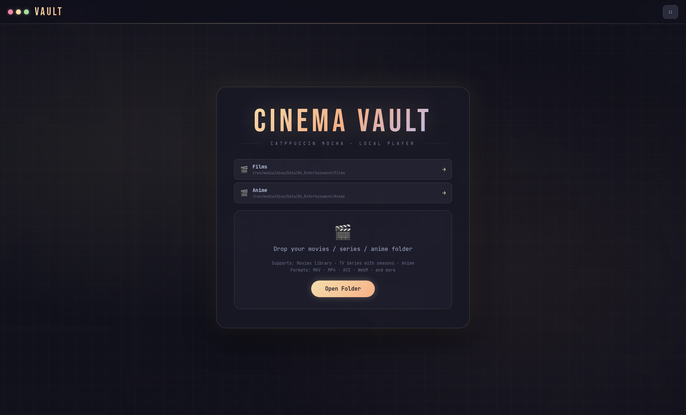
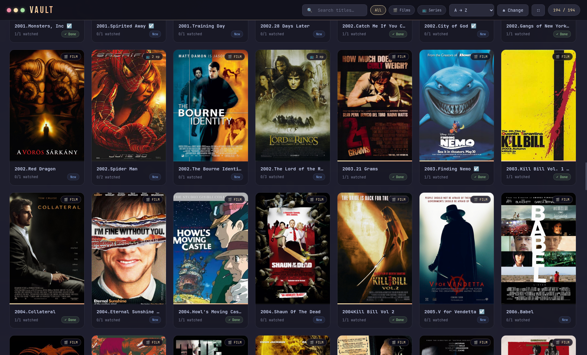

<div align="center">

# 🎬 Cinema Vault

**A local movies, series & anime player — Catppuccin Mocha theme.**

[](https://www.electronjs.org/)
[](#)
[](https://catppuccin.com/)

</div>

Part of **[Local Vaults Suite](../../README.md)**.

<div align="center">


</div>

## ✨ Features

- **Direct `file://` playback** — movies stream straight off disk, no copying into memory
- **Movies, series & anime** in one library, auto-detected from folder structure
- **Continue Watching** — remembers exactly where you stopped, per episode/movie
- **Subtitles** — SRT/ASS/SSA auto-converted to WebVTT on the fly, with automatic Arabic-text detection for correct alignment
- **Keyboard-driven player**
  | Key | Action |
  |---|---|
  | `→` / `←` | Seek ±10s |
  | `Space` | Play / Pause |
  | `F` | Fullscreen |
  | `M` | Mute |
  | `Esc` | Exit fullscreen / back to library |
  | Double-click video | Toggle fullscreen |
- **Recent folders** remembered on the welcome screen
- **Right-click utilities** — show in file manager, copy path

## 📁 Supported structure

```text
Movies_And_Series/
├── Inception (2010)/
│   └── Inception.mkv
├── Some Series/
│   ├── Season 1/
│   │   ├── S01E01.mkv
│   │   └── S01E01.srt
│   └── Season 2/
└── Some Anime/
    └── Episode_01.mp4
```

Open the root folder as a **Library**, or open a single title/season folder directly.

## 🚀 Install (Arch Linux / omarchy)

```bash
chmod +x install.sh
./install.sh
```

Installs to `~/.local/share/cinema-vault`, sets up Electron on first run, and adds a `cinema-vault` launcher + desktop entry (searchable in `rofi`/`wofi` as **cinema** or **vault**).

Run it:

```bash
cinema-vault
```

## 🛠️ Development

```bash
npm install
npm start
```

## 🗑️ Uninstall

```bash
~/.local/share/cinema-vault/uninstall.sh
```

---

<div align="center">

Built by **[Diea Abdeltwab](https://github.com/diea-abdeltwab)** — part of [Local Vaults Suite](../../README.md) 🇪🇬

</div>
