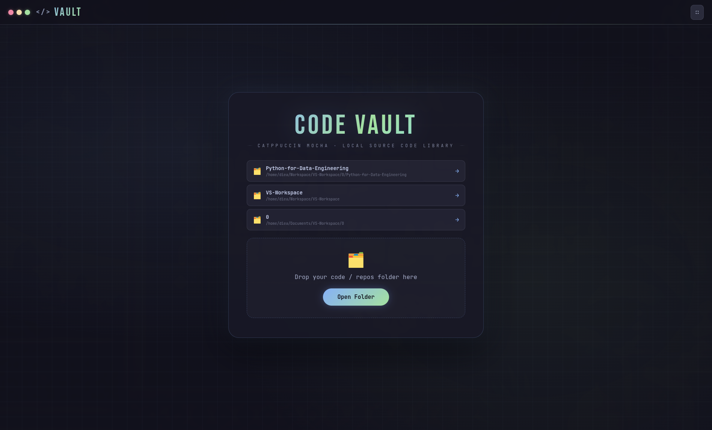
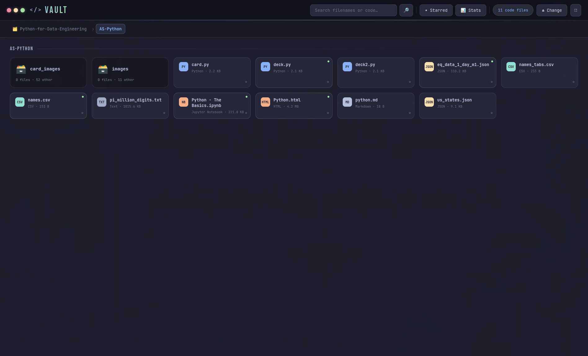
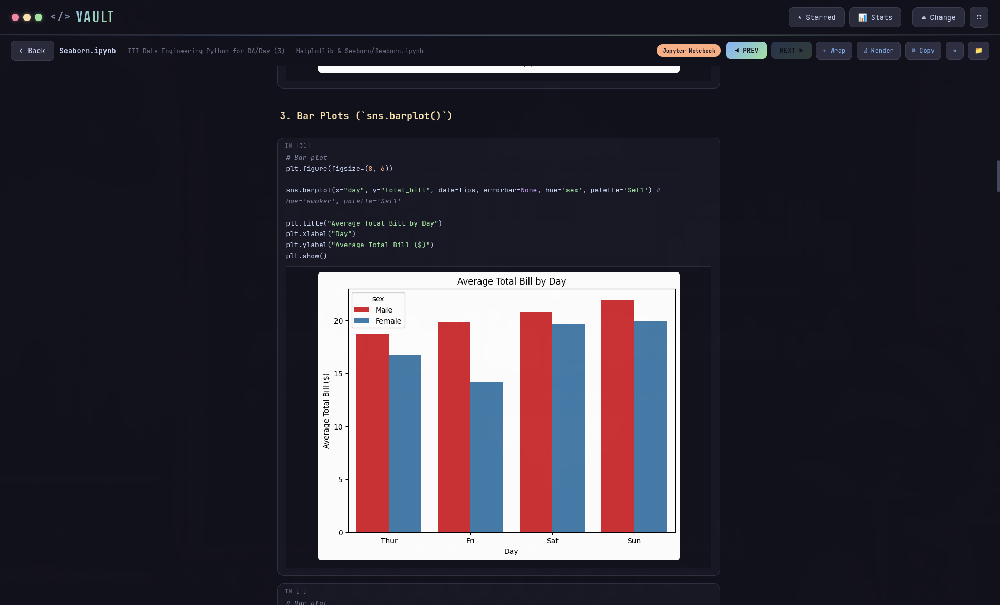

<div align="center">

# 💻 Code Vault

**A local source-code library & viewer — Catppuccin Mocha theme.**

[](https://www.electronjs.org/)
[](#)
[](https://catppuccin.com/)

</div>

Part of **[Local Vaults Suite](../../README.md)**.

<div align="center">


<br/>

</div>

An offline archive/reader for old projects, cloned repos, and code snippets you've collected over the years — browse by folder, read with syntax highlighting, and search across file contents without opening an editor.

## ✨ Features

- **Recursive project scanning** — point it at a root folder full of projects/repos and browse them like a file tree
- **Syntax highlighting** for dozens of languages (JS/TS/JSX/TSX, Python, C/C++, and more) via a built-in language map
- **Jupyter Notebook rendering** — `.ipynb` files render inline (markdown cells, code, and output — including plots), or view the raw notebook JSON
- **Full-text content search** across every file under the current root, not just filenames
- **Project stats** — quick per-folder breakdown (file counts, language mix)
- **Starring** — flag files for quick access later
- **Recently opened** roots and files, remembered across sessions
- **Right-click utilities** — show in file manager, copy path/contents, open external links found in code

## 🚀 Install (Arch Linux / omarchy)

```bash
chmod +x install.sh
./install.sh
```

Installs to `~/.local/share/code-vault`, sets up Electron on first run, and adds a `code-vault` launcher + desktop entry (searchable in `rofi`/`wofi` as **code** or **vault**).

Run it:

```bash
code-vault
```

## 🛠️ Development

```bash
npm install
npm start
```

## 🗑️ Uninstall

```bash
~/.local/share/code-vault/uninstall.sh
```

---

<div align="center">

Built by **[Diea Abdeltwab](https://github.com/diea-abdeltwab)** — part of [Local Vaults Suite](../../README.md) 🇪🇬

</div>
