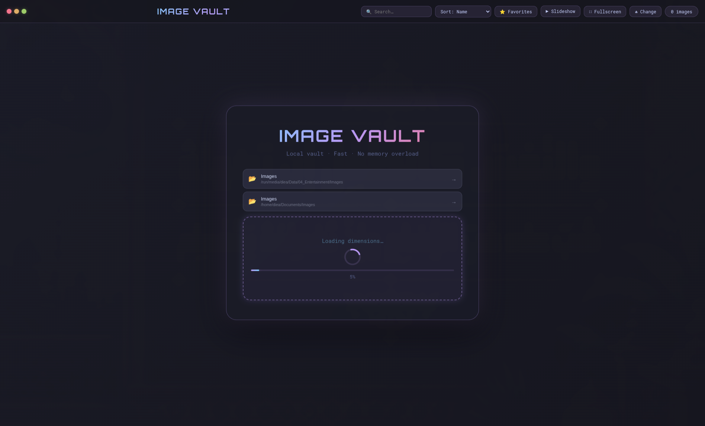
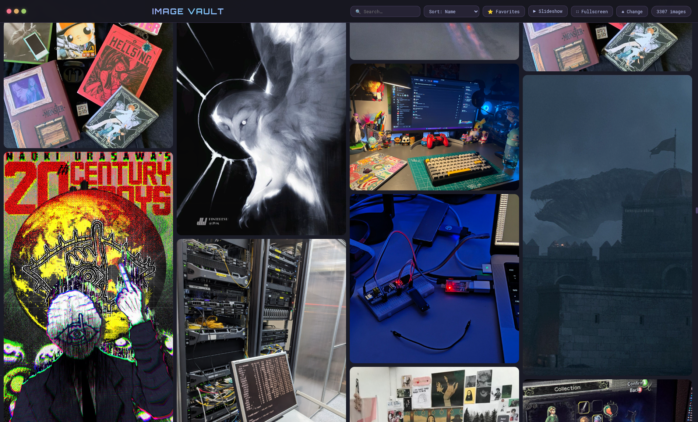

<div align="center">

# 🖼️ Image Vault

**A local image gallery, built for very large libraries — Catppuccin Mocha theme.**

[](https://www.electronjs.org/)
[](#)
[](https://catppuccin.com/)

</div>

Part of **[Local Vaults Suite](../../README.md)**.

<div align="center">


</div>

## ✨ Features

- **Virtual scrolling** — only renders what's on screen (+ buffer), so a folder of 3,000+ images doesn't choke the app
- **Direct `file://` loading** — no blob URLs filling up RAM
- **True masonry layout** — Pinterest-style, using each image's real dimensions
- **Lightbox** — full-quality view with keyboard navigation (`←` `→` `Esc`)
- **Favorites** — star images for quick access
- **Slideshow mode** — hands-free browsing
- **Fullscreen** toggle
- **Instant search** by filename
- **Drag & drop** — drop a folder or individual images straight onto the app

## 🏗️ Architecture

```text
src/
  main.js      — Electron main process (file system, dialogs, IPC)
  preload.js   — contextBridge (contextIsolation on)
  index.html   — UI shell
  renderer.js  — Gallery logic + virtual-scroll engine
```

## 🚀 Install (Arch Linux / omarchy)

```bash
chmod +x install.sh
./install.sh
```

Installs to `~/.local/share/image-vault`, sets up Electron on first run, and adds an `image-vault` launcher + desktop entry (searchable in `rofi`/`wofi` as **image** or **vault**).

Run it:

```bash
image-vault
```

## 🛠️ Development

```bash
npm install
npm start
```

Optional AppImage build:

```bash
npm run build
```

Output lands in `dist/` as a self-contained `.AppImage`.

## 🗑️ Uninstall

```bash
~/.local/share/image-vault/uninstall.sh
```

---

<div align="center">

Built by **[Diea Abdeltwab](https://github.com/diea-abdeltwab)** — part of [Local Vaults Suite](../../README.md) 🇪🇬

</div>
