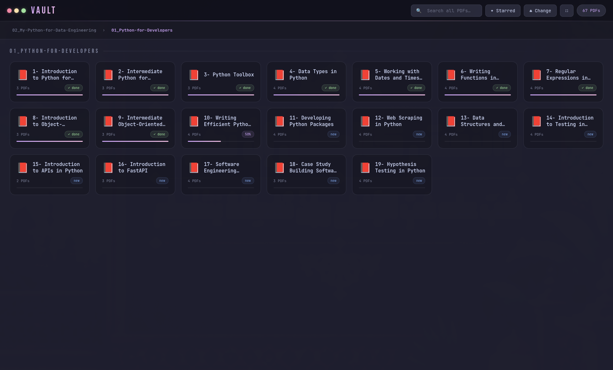

<div align="center">

# 📄 PDFs Vault

**A local PDF library browser, built for deep nested folders — Catppuccin Mocha theme.**

[](https://www.electronjs.org/)
[](#)
[](https://catppuccin.com/)

</div>

Part of **[Local Vaults Suite](../../README.md)**.

<div align="center">


</div>

Built for deep, nested structures like Coursera/DataCamp course exports (`Category → Track → Course → Module → chapter1.pdf`) — but works for any folder of PDFs.

## ✨ Features

- **Recursive scan, any depth** — point it at a root folder and it walks the entire tree, no matter how deeply the PDFs are nested. Folders with no PDFs anywhere inside are skipped automatically.
- **Breadcrumb navigation** — click into category → course → module like a file manager, with a clickable trail back up
- **Global search** — search PDF filenames across the *entire* scanned tree from any screen
- **Reading progress** — opened PDFs are marked read; folders show a progress bar / percentage / "done" badge once everything inside has been opened at least once
- **Starring** — star any PDF for quick access via the ★ Starred view
- **In-app reader** — embedded viewer with Prev/Next to move through every PDF in the current folder
- **Recent folders** — the last 2 opened roots are remembered on the welcome screen
- **Drag & drop** or **Open Folder** dialog to pick your library root

## 🚀 Install (Arch Linux / omarchy)

```bash
chmod +x install.sh
./install.sh
```

Installs to `~/.local/share/pdfs-vault`, sets up Electron on first run, and adds a `pdfs-vault` launcher + desktop entry (searchable in `rofi`/`wofi` as **pdfs** or **vault**).

Run it:

```bash
pdfs-vault
```

## 🛠️ Development

```bash
npm install
npm start
```

## 📖 Usage

1. Open the app, then either drag a folder onto the window or click **Open Folder** and pick the root.
2. Browse: each screen shows the subfolders and any PDFs directly inside the current one. Click a folder to go deeper, click a PDF to read it.
3. Use the titlebar search to find a PDF by name anywhere in the tree.
4. Star a PDF from its card or from the reader; revisit everything you've starred via **★ Starred**.

## 📝 Notes

- Folders that contain *only* PDFs (no subfolders) get a 📕 "leaf" icon; folders that still contain subfolders get a 📂 icon.
- Progress and stars are stored locally under `~/.config/pdfs-vault/`, keyed by full file path — they persist across restarts as long as files aren't moved or renamed.

## 🗑️ Uninstall

```bash
~/.local/share/pdfs-vault/uninstall.sh
```

---

<div align="center">

Built by **[Diea Abdeltwab](https://github.com/diea-abdeltwab)** — part of [Local Vaults Suite](../../README.md) 🇪🇬

</div>
