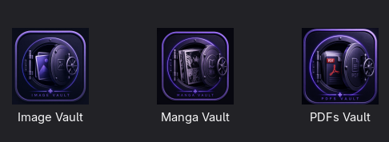
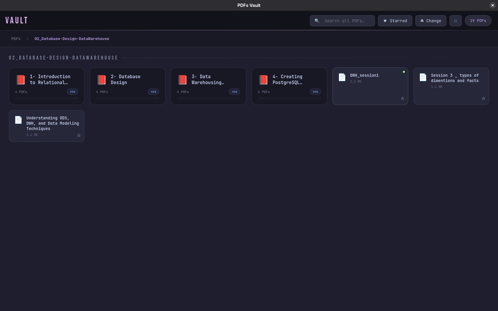

<div align="center">


<br/>

[](https://www.electronjs.org/)
[%20%C2%B7%20any%20Linux-1793D1?style=for-the-badge&logo=linux&logoColor=white)](#-quick-start)
[](https://catppuccin.com/)
[](#-works-offline--one-shared-electron)
[](#-license)


</div>

<br/>

> 🪟 **GNOME edition** — the main, actively maintained version. Using **Hyprland / omarchy**? See the [Hyprland edition](../hyprland) (all seven vaults). Back to the [repo overview](../README.md).

## 🗃️ What is this?

**Local Vaults Suite** is a family of small, fast, **fully local** Electron apps — one per media type — for people who keep large personal libraries on disk (manga, PDFs, images, movies, code, music…) and just want a clean, native-feeling browser for them. No cloud sync, no accounts, no telemetry — point an app at a folder and it just works.

Every app shares the same DNA:

- 🎨 **Catppuccin Mocha** theme, top to bottom
- ⚡ **Direct `file://` loading** — images, videos and PDFs are streamed by the browser itself, never copied into RAM as blobs
- 📂 **Point-at-a-folder** workflow — Open Folder or drag & drop, no import step
- 🧠 **Built for huge libraries** — scanning happens in a worker thread, so the window never freezes (tested on a 300,000-file library)
- 📴 **Works offline** — one shared Electron runtime installed *once*; after that, no `npm`, no `npx`, no internet
- 🪟 **Native window bar** on GNOME/KDE (close, minimise, drag, resize) — and its own coloured dots on tiling WMs like Hyprland/Sway
- 💾 **Local, per-app progress / starred / recent state** — persisted with Electron's `userData`
- 🐧 One installer for **Fedora / GNOME** (the primary target) — also runs on Arch and other Linux distros; launcher entries included
- 🔒 `contextIsolation` + a minimal `preload.js` bridge — no Node access from the renderer

<div align="center">



<sub>Every vault, one keystroke away — launched straight from the app launcher (press <b>Super</b>, type <code>vault</code>).</sub>

</div>

---

## 📦 The Apps

| App | For | Highlights | Docs |
|---|---|---|---|
| 📚 **[Manga Vault](./apps/manga-vault)** | Manga & manhwa | Read progress, chapter grid, **image chapters and PDF volumes in the same series** (side by side or in a `PDF/` sub-folder), instant reopen of huge libraries, pages preloaded ahead | [README](./apps/manga-vault/README.md) |
| 📄 **[PDFs Vault](./apps/pdfs-vault)** | Any nested PDF library | Recursive scan at any depth, breadcrumbs, global search, starring, open-in-system-viewer | [README](./apps/pdfs-vault/README.md) |
| 🖼️ **[Image Vault](./apps/image-vault)** | Large image & video galleries | Virtual-scroll masonry grid, cached thumbnails, lightbox, favorites, slideshow — thousands of images smoothly, **HEIC/HEIF photos included** | [README](./apps/image-vault/README.md) |

<details>
<summary><b>🎞️ More vaults in the family</b> (in the <a href="../hyprland">Hyprland edition</a>)</summary>

<br/>

| App | For | Highlights |
|---|---|---|
| 🎬 **[Cinema Vault](../hyprland/apps/cinema-vault)** | Movies, series & anime | Subtitle rendering (SRT/ASS → VTT), continue-watching, keyboard-driven player |
| 💻 **[Code Vault](../hyprland/apps/code-vault)** | Local source-code archives | Syntax highlighting, full-text content search, project stats |
| 🎵 **[Music Vault](../hyprland/apps/music-vault)** | Music & audio clips | Library + clip playback, subtitle/lyric support, recent folders |
| 📺 **[Video Vault](../hyprland/apps/video-vault)** | A local, YouTube-style video shelf | Thumbnails, subtitles, continue-watching |

</details>

Each app lives in its own folder under `apps/` with its own `package.json` — they're independent apps, released together as one family and installed by one shared installer.

---

## 📸 Screenshots

<div align="center">

### 📚 Manga Vault — your whole library, with reading progress


<sub>14 series · 1,700+ chapters · covers load only when they get close to the screen · progress saved per chapter.</sub>

<br/><br/>

### 🖼️ Image Vault — 3,500+ images in a smooth masonry grid


<sub>Virtual scrolling + cached thumbnails: only what you can see (plus a safety margin) exists in the DOM.</sub>

<br/><br/>

### 📄 PDFs Vault — nested folders, breadcrumbs, progress



<sub>Folders at any depth, a progress bar per folder, a dot on what you've already opened, ☆ to star, global search across the whole library.</sub>

</div>

---

## 🚀 Quick Start

> **Needs `node` + `npm` once** (only to download Electron the first time).
> Fedora: `sudo dnf install -y nodejs npm` · Arch: `sudo pacman -S nodejs npm`

```bash
git clone https://github.com/diea-abdeltwab/local-vaults-suite.git
cd local-vaults-suite/gnome
chmod +x install.sh
./install.sh                 # all three apps
# or pick some:
./install.sh manga-vault pdfs-vault
```

Then open them from the launcher (press **Super**, type `vault`) — or from a terminal:

```bash
image-vault
manga-vault
pdfs-vault
```

| Command | What it does |
|---|---|
| `./install.sh` | Install Electron (once) + all three apps |
| `./install.sh <app> [<app>…]` | Install only the named app(s) |
| `./install.sh --runtime-only` | Just (re)install the shared Electron |
| `./install.sh --force-runtime` | Reinstall Electron even if it is already there |
| `~/.local/share/local-vaults/uninstall.sh` | Remove all apps (keeps Electron and your progress) |
| `… uninstall.sh <app>` | Remove only one app |
| `… uninstall.sh --runtime --data` | Remove **everything**, including Electron and saved progress |

### ⚙️ Environment switches

| Variable | Effect |
|---|---|
| `VAULT_FRAME=native` / `custom` | Force the desktop's window bar, or the app's own coloured dots (also `--frame=custom`) |
| `VAULT_WAYLAND=1` | Native Wayland rendering (sharper on fractional scaling; off by default) |
| `VAULT_DEBUG=1` | Print whether the GPU is really used — handy when something stutters |

---

## 📴 Works offline — one shared Electron

```text
~/.local/share/local-vaults/
├── runtime/             ← ONE shared Electron 31.7.7 (≈270 MB, downloaded once)
├── apps/
│   ├── image-vault/     ← app code only (≈0.5 MB each, no node_modules)
│   ├── manga-vault/
│   └── pdfs-vault/
└── uninstall.sh
~/.local/bin/<app>                      ← launcher: runs the shared Electron directly
~/.local/share/applications/<app>.desktop
~/.config/<app>/                        ← your progress, favorites, window size, thumbnail cache
```

- **No per-app `npm install`.** Electron is installed once and shared by every app.
- **The launchers never call `npm` or `npx`**, so the apps start with no internet — even right after a reboot. Everything lives under `~/.local/share` (persistent).
- Fonts are bundled, so the UI looks identical offline.
- Re-running `./install.sh` never re-downloads Electron if it is already installed.

---

## ⚡ Built for big libraries

| | What happens | Why it matters |
|---|---|---|
| 📚 **Manga scan** | Runs in a **worker thread**, streams series to the UI as they are found, costs **2 directory reads per series** instead of opening every chapter | A 300,000-file library: main process blocked **8.7 s → 1 ms**, first covers in ≈0.5 s — no more "Not Responding" |
| 📚 **Instant reopen** | The last scan of each library is cached, then silently re-checked | Reopening shows your library immediately; "Library updated" appears if something changed |
| 📚 **Reader** | Pages start loading ~6 screens ahead; the next chapter's first pages are prefetched | Pages are already there when you scroll to them (tested on a 1,500-page chapter) |
| 🖼️ **Image sizes** | Read from file **headers** (JPEG/PNG/WebP/GIF/BMP/AVIF/MP4/WebM, EXIF-rotation aware) | Gallery opens in ≈1 s instead of decoding every picture first |
| 🖼️ **Thumbnails** | Made once off the main thread, cached on disk (≤ 1.5 GB), prepared in the background while you're idle | Scrolling shows small images, never full-size decodes |
| 🖼️ **Virtual scroll** | ~2 screens of tiles kept alive, destroyed only far away | No blank flashes when scrolling back |
| 🖼️ **Videos** | Source attached only near the screen; plays only while visible | Hundreds of videos don't decode at once |
| 📄 **PDFs** | Opened with the thumbnail sidebar collapsed; **↗** opens the file in the system viewer | Big scanned PDFs scroll better |

---

## 🎨 Design language

<div align="center">

| Color | Hex | Role |
|---|---|---|
| 🟣 Mauve | `#CBA6F7` | Primary accent |
| 🌸 Pink | `#F5C2E7` | Secondary accent |
| 💜 Lavender | `#B4BEFE` | Links, highlights |
| 🟢 Green | `#A6E3A1` | Success / progress |
| 🔵 Blue | `#89B4FA` | Info |
| ⬛ Base | `#1E1E2E` | Background |
| ⬜ Text | `#CDD6F4` | Foreground text |

</div>

Full [Catppuccin Mocha](https://catppuccin.com/palette/) palette across every screen — same feel whether you're reading manga at midnight or flipping through lecture PDFs.

---

## 🏗️ Architecture (shared pattern)

Each app is a small, sandboxed Electron shell:

```text
apps/<app-name>/
├── src/
│   ├── main.js          ← Electron main process: dialogs, IPC handlers, persistence
│   ├── common.js        ← shared: window frame, safe JSON saves, single-instance (same file in every app)
│   ├── scan-worker.js   ← folder scan in a worker thread (manga, image)
│   ├── preload.js       ← contextBridge — the only Node-facing surface
│   ├── index.html       ← UI shell
│   ├── renderer.js      ← UI logic (no Node access, browser-only)
│   └── fonts/           ← bundled fonts (works offline)
├── assets/icon.png
└── package.json
install.sh · uninstall.sh · lib/common.sh   ← one shared installer for the whole suite
```

No frameworks, no bundler — plain HTML/CSS/JS renderers kept intentionally small and dependency-light, which is also why they start in well under a second.

---

## 🛠️ Troubleshooting

<details>
<summary><b>The app stutters / pictures blink</b></summary>

<br/>

Run `VAULT_DEBUG=1 image-vault` in a terminal. If the GPU status says `disabled_software`, the graphics driver is rendering on the CPU — that's the cause, not the app.

</details>

<details>
<summary><b>"The SUID sandbox helper binary was found, but is not configured correctly"</b></summary>

<br/>

Run the app with `--no-sandbox`, e.g. `image-vault --no-sandbox` (not expected on Fedora, but harmless).

</details>

<details>
<summary><b>The terminal commands (<code>manga-vault</code> …) are not found</b></summary>

<br/>

Add `~/.local/bin` to your `PATH`. The apps still appear in the launcher either way.

</details>

<details>
<summary><b>I installed with the old per-app installer</b></summary>

<br/>

The new installer tells you if an old copy with its own `node_modules` exists in `~/.local/share/<app>` — it is safe to delete (`rm -rf ~/.local/share/<app>`). Your progress in `~/.config/<app>/` is kept.

</details>

---

## 🧑‍💻 About the author

<div align="center">

**Diea Abdeltwab** — Data Engineer · Software Engineer · Cairo, Egypt 🇪🇬

*Turning raw data into reliable systems — and, on the side, building the local-first tools I actually want to use.*

[](https://www.linkedin.com/in/diea-abdeltwab)
[](https://github.com/diea-abdeltwab)
[](mailto:diea.abdeltwab@gmail.com)

</div>

---

## 🧩 Third-party

| Component | Used for | License |
|---|---|---|
| [Electron](https://www.electronjs.org/) | App runtime (installed once, shared) | MIT |
| [libheif-js](https://github.com/catdad-experiments/libheif-js) (libheif + libde265, WebAssembly) | Decoding HEIC/HEIF photos in Image Vault — bundled unmodified in `apps/image-vault/src/vendor/` | LGPL-3.0 |
| JetBrains Mono, Bebas Neue, Orbitron, Roboto Mono | Bundled UI fonts | SIL OFL 1.1 |

---

## 📜 License

MIT — use it, fork it, theme it however you like. See [`LICENSE`](./LICENSE).

<div align="center">

⭐ **If any of these vaults are useful to you, a star helps a lot!** ⭐


</div>
