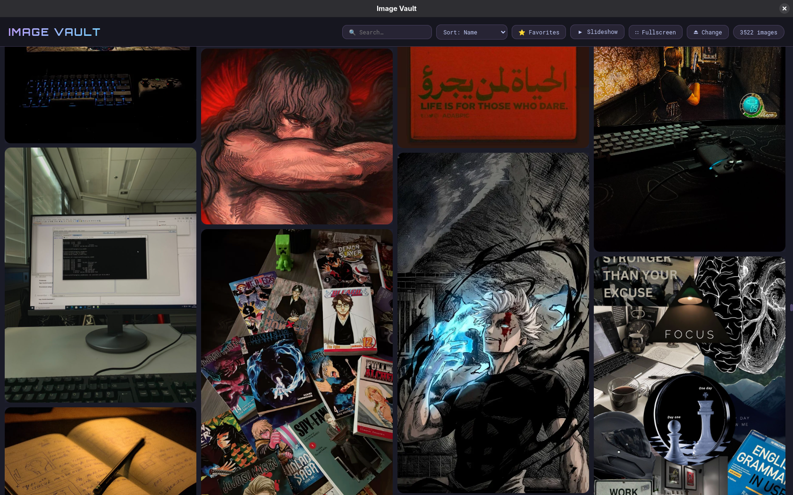

<div align="center">

# 🖼️ Image Vault

**A local image gallery, built for very large libraries — Catppuccin Mocha theme.**

[](https://www.electronjs.org/)
[](#)
[](https://catppuccin.com/)

</div>

Part of **[Local Vaults Suite](../../README.md)**.

<div align="center">


</div>

## ✨ Features

- **Virtual scrolling** — only renders what's on screen (+ buffer), so a folder of 3,000+ images doesn't choke the app
- **Direct `file://` loading** — no blob URLs filling up RAM
- **True masonry layout** — Pinterest-style, using each image's real dimensions
- **Lightbox** — full-quality view with keyboard navigation (`←` `→` `Esc`)
- **Favorites** — star images for quick access
- **Slideshow mode** — hands-free browsing
- **Fullscreen** toggle
- **Instant search** by filename
- **Drag & drop** — drop a folder or individual images straight onto the app

## 🏗️ Architecture

```text
src/
  main.js      — Electron main process (file system, dialogs, IPC)
  common.js    — shared window / persistence / localfile:// helpers
  preload.js   — contextBridge (contextIsolation on)
  fonts/       — bundled Orbitron + Roboto Mono (works offline)
  index.html   — UI shell
  renderer.js  — Gallery logic + virtual-scroll engine
```

## 🚀 Install (Fedora / GNOME · Arch · any Linux)

From the repo root (two folders up) — installs the shared Electron runtime once, then the app:

```bash
./install.sh image-vault        # or just ./install.sh for all three apps
```

Run it from the app grid (press Super, type **vault**) or from a terminal:

```bash
image-vault
```

- **Offline-proof:** Electron is downloaded **once** into `~/.local/share/local-vaults/runtime` and shared by all three apps. The launcher runs it directly (no `npm`/`npx`), so the app starts with no internet, even right after a reboot.
- **Window bar:** on GNOME/KDE you get the normal desktop title bar. On tiling WMs (Hyprland, Sway, i3…) the app draws its own coloured window dots. Force either with `VAULT_FRAME=native` / `VAULT_FRAME=custom` (or `image-vault --frame=custom`).
- Optional native Wayland rendering: `VAULT_WAYLAND=1 image-vault`.

## 🛠️ Development

Use the shared runtime instead of a per-app `node_modules`:

```bash
cd apps/image-vault
~/.local/share/local-vaults/runtime/node_modules/.bin/electron .
```

`src/common.js` is identical in all three apps (window handling, atomic JSON saves, `localfile://` protocol) — if you change it, copy it to the other two.

## 🗑️ Uninstall

```bash
~/.local/share/local-vaults/uninstall.sh image-vault   # keeps Electron + your saved progress
~/.local/share/local-vaults/uninstall.sh --runtime --data   # remove everything
```

---

<div align="center">

Built by **[Diea Abdeltwab](https://github.com/diea-abdeltwab)** — part of [Local Vaults Suite](../../README.md) 🇪🇬

</div>
