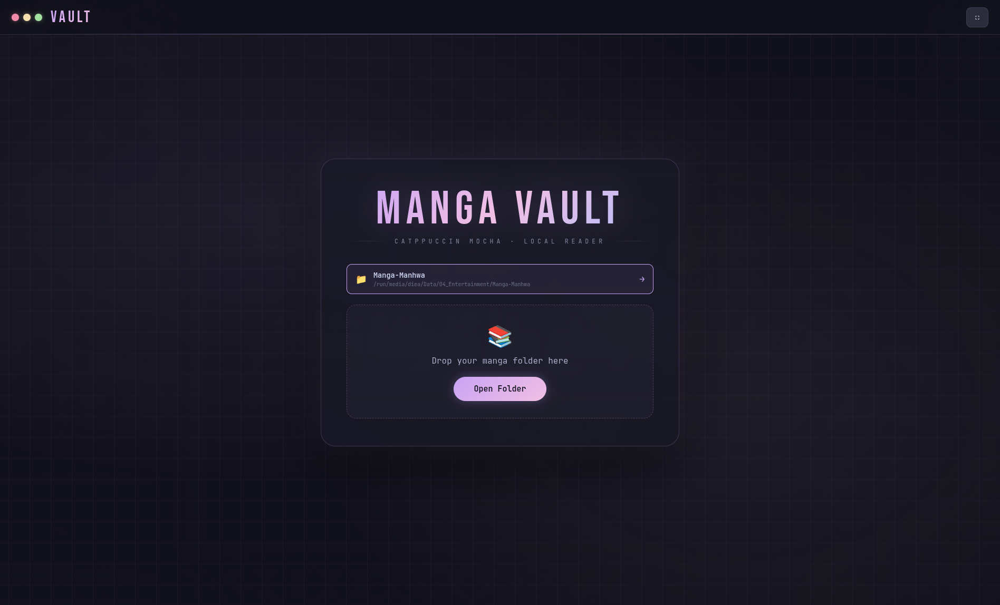
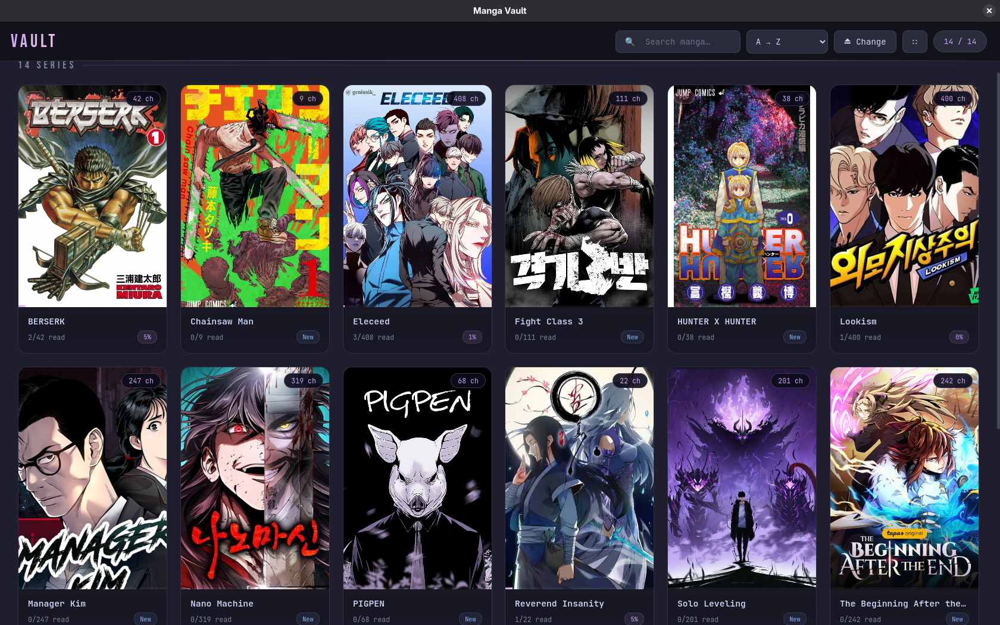

<div align="center">

# 📚 Manga Vault

**A local manga & manhwa reader — Catppuccin Mocha theme.**

[](https://www.electronjs.org/)
[](#)
[](https://catppuccin.com/)

</div>

Part of **[Local Vaults Suite](../../README.md)**.

<div align="center">


</div>

## ✨ Features

- **Direct `file://` loading** — no blob URLs filling up RAM, pages load straight from disk
- **Read Progress** — remembers what you've read, persists after closing the app
- **Continue Reading** — jumps back to the last chapter you opened
- **Library View** — grid with thumbnails and progress badges
- **Chapter Grid** — chapters with Read/Current indicators
- **Reader modes** — Normal / Compact / Fit Width / Wide
- **Chapter progress bar** under the header, moves as you scroll
- **Auto-hide header** — hides while reading, reappears when you move the mouse
- **Right-click zoom** — right-click any page to open it fullsize
- **Keyboard** — `→` / `←` next/previous chapter, `Esc` back, `F` fullscreen
- **Sort** — A→Z, Z→A, By Progress, Most Read
- **Instant search** in the library
- **PDF-volume support** — PDF and image chapters can mix inside the same manga folder; PDF volumes get a real thumbnail of their first page

## 📁 Supported structure

```text
Manga_And_Manhwa/        ← open this as a Library
├── BERSERK/
│   ├── Chapter_1/
│   │   ├── 001.jpg
│   │   └── ...
│   └── Chapter_2/
└── Fight Class 3/
    ├── Chapter_1/
    └── ...
```

Open the root as a **Library**, open a single manga folder directly, or just drag & drop a folder onto the welcome screen.

## 🚀 Install (Fedora / GNOME · Arch · any Linux)

From the repo root (two folders up) — installs the shared Electron runtime once, then the app:

```bash
./install.sh manga-vault        # or just ./install.sh for all three apps
```

Run it from the app grid (press Super, type **vault**) or from a terminal:

```bash
manga-vault
```

- **Offline-proof:** Electron is downloaded **once** into `~/.local/share/local-vaults/runtime` and shared by all three apps. The launcher runs it directly (no `npm`/`npx`), so the app starts with no internet, even right after a reboot.
- **Window bar:** on GNOME/KDE you get the normal desktop title bar. On tiling WMs (Hyprland, Sway, i3…) the app draws its own coloured window dots. Force either with `VAULT_FRAME=native` / `VAULT_FRAME=custom` (or `manga-vault --frame=custom`).
- Optional native Wayland rendering: `VAULT_WAYLAND=1 manga-vault`.


## 🔀 Image chapters + PDF volumes in one series

A series can contain both. All of these work:

```text
My Manga/
├── Chapter 1/ …            ← image chapters
├── Chapter 2/ …
├── Vol 1.pdf               ← PDF volumes next to them
└── PDF/                    ← …or inside a sub-folder (also: Volumes, Tomes, Books, any folder that holds only PDFs)
    └── Vol 2.pdf
```

The chapter list shows two groups — **🖼 Chapters** and **📕 PDF Volumes** — each in numeric order, and the reader's prev/next walks through one group and then the other. **⇅ swap order** puts the volumes first (remembered).

## 🛠️ Development

Use the shared runtime instead of a per-app `node_modules`:

```bash
cd apps/manga-vault
~/.local/share/local-vaults/runtime/node_modules/.bin/electron .
```

`src/common.js` is identical in all three apps (window handling, atomic JSON saves, `localfile://` protocol) — if you change it, copy it to the other two.

## 🗑️ Uninstall

```bash
~/.local/share/local-vaults/uninstall.sh manga-vault   # keeps Electron + your saved progress
~/.local/share/local-vaults/uninstall.sh --runtime --data   # remove everything
```

---

<div align="center">

Built by **[Diea Abdeltwab](https://github.com/diea-abdeltwab)** — part of [Local Vaults Suite](../../README.md) 🇪🇬

</div>
