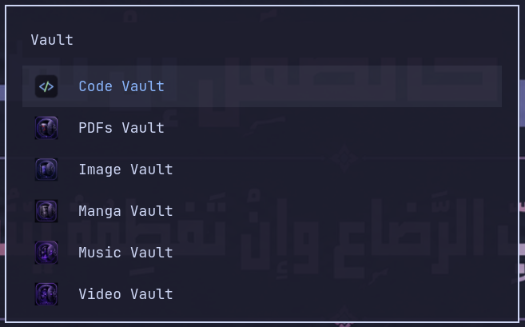

<div align="center">


<br/>

[](https://www.electronjs.org/)
[-1793D1?style=for-the-badge&logo=linux&logoColor=white)](#)
[](https://catppuccin.com/)
[](#-license)


</div>

<br/>

> 🐧 **Hyprland / omarchy edition** (the original seven apps). Running **Fedora / GNOME**? Use the newer [GNOME edition](../gnome) — shared offline runtime, native window bar, big-library performance, HEIC support. Back to the [repo overview](../README.md).

## 🗃️ What is this?

**Local Vaults Suite** is a family of seven small, fast, **fully local** Electron apps — one per media type — for people who keep large personal libraries on disk (movies, manga, PDFs, code, music, video clips, images) and just want a clean, native-feeling browser for them. No cloud sync, no accounts, no telemetry — point an app at a folder and it just works.

Every app shares the same DNA:

- 🎨 **Catppuccin Mocha** theme, top to bottom
- ⚡ **Direct `file://` loading** — nothing gets copied into RAM as blob URLs
- 📂 **Point-at-a-folder** workflow — Open Folder or drag & drop, no import step
- 💾 **Local, per-app progress/starred/recent state** — persisted with Electron's `userData`
- 🐧 Installer scripts for **Arch Linux / [omarchy](https://omarchy.org/)** — `rofi`/`wofi` launcher entries included
- 🔒 `contextIsolation` + a minimal `preload.js` bridge — no Node access from the renderer

<div align="center">



<sub>Every vault, one keystroke away — launched straight from <code>rofi</code>/<code>wofi</code>.</sub>

</div>

---

## 📦 The Apps

| App | For | Highlights | Docs |
|---|---|---|---|
| 🎬 **[Cinema Vault](./apps/cinema-vault)** | Movies, series & anime | Subtitle rendering (SRT/ASS → VTT), continue-watching, keyboard-driven player | [README](./apps/cinema-vault/README.md) |
| 📚 **[Manga Vault](./apps/manga-vault)** | Manga & manhwa | Read progress, chapter grid, mixed image/PDF volumes, auto-hide reader header | [README](./apps/manga-vault/README.md) |
| 📄 **[PDFs Vault](./apps/pdfs-vault)** | Any nested PDF library | Recursive scan at any depth, breadcrumbs, global search, starring | [README](./apps/pdfs-vault/README.md) |
| 💻 **[Code Vault](./apps/code-vault)** | Local source-code archives | Syntax highlighting, full-text content search, project stats | [README](./apps/code-vault/README.md) |
| 🎵 **[Music Vault](./apps/music-vault)** | Music & audio clips | Library + clip playback, subtitle/lyric support, recent folders | [README](./apps/music-vault/README.md) |
| 📺 **[Video Vault](./apps/video-vault)** | A local, YouTube-style video shelf | Thumbnails, subtitles, continue-watching | [README](./apps/video-vault/README.md) |
| 🖼️ **[Image Vault](./apps/image-vault)** | Large image galleries | Virtual-scroll masonry grid, lightbox, handles thousands of images smoothly | [README](./apps/image-vault/README.md) |

Each app lives in its own folder with its own `package.json`, `install.sh`, and `uninstall.sh` — they're independent apps, just released together as one family.

---

## 🚀 Quick Start (any app)

Every app follows the same three steps:

```bash
cd apps/<app-name>
chmod +x install.sh
./install.sh
```

This copies the app to `~/.local/share/<app-name>`, installs Electron locally on first run, drops a launcher in `~/.local/bin`, and adds a `.desktop` entry so it shows up in `rofi`/`wofi`/your app launcher.

Run it:

```bash
<app-name>          # e.g. cinema-vault, manga-vault, pdfs-vault...
```

Or for development, inside any app folder:

```bash
npm install
npm start
```

Uninstall any app with:

```bash
~/.local/share/<app-name>/uninstall.sh
```

---

## 🎨 Design language

<div align="center">

| Color | Hex | Role |
|---|---|---|
| 🟣 Mauve | `#CBA6F7` | Primary accent |
| 🌸 Pink | `#F5C2E7` | Secondary accent |
| 💜 Lavender | `#B4BEFE` | Links, highlights |
| 🟢 Green | `#A6E3A1` | Success / progress |
| 🔵 Blue | `#89B4FA` | Info |
| ⬛ Base | `#1E1E2E` | Background |
| ⬜ Text | `#CDD6F4` | Foreground text |

</div>

Full [Catppuccin Mocha](https://catppuccin.com/palette/) palette across every screen — same feel whether you're reading manga at midnight or scrubbing through a movie.

---

## 🏗️ Architecture (shared pattern)

Each app is a small, sandboxed Electron shell:

```text
<app-name>/
├── src/
│   ├── main.js       ← Electron main process: fs scanning, dialogs, IPC handlers
│   ├── preload.js    ← contextBridge — the only Node-facing surface
│   ├── index.html    ← UI shell
│   └── renderer.js   ← UI logic (no Node access, browser-only)
├── assets/icon.png
├── install.sh / uninstall.sh
└── package.json
```

No frameworks, no bundler — plain HTML/CSS/JS renderers kept intentionally small and dependency-light, which is also why they start in well under a second.

---

## 🧑‍💻 About the author

<div align="center">

**Diea Abdeltwab** — Data Engineer · Software Engineer · Cairo, Egypt 🇪🇬

*Turning raw data into reliable systems — and, on the side, building the local-first tools I actually want to use.*

[](https://www.linkedin.com/in/diea-abdeltwab/)
[](https://github.com/diea-abdeltwab)
[](mailto:dieaabdeltwab2024@gmail.com)

</div>

---

## 📜 License

MIT — use it, fork it, theme it however you like. See [`LICENSE`](./LICENSE).

<div align="center">

⭐ **If any of these vaults are useful to you, a star helps a lot!** ⭐


</div>
